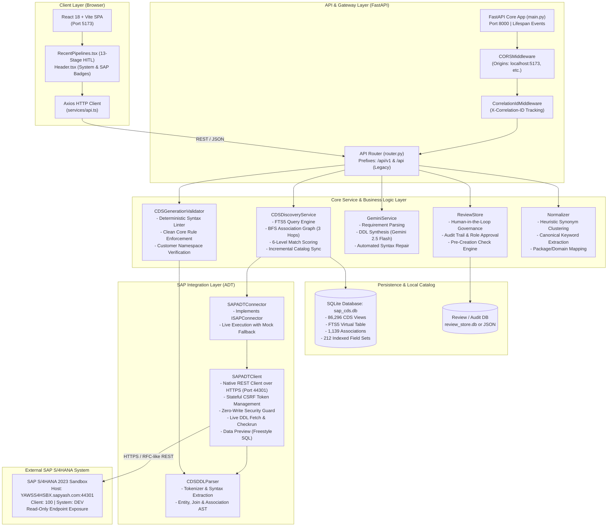

# 02 - System Architecture

## 1. High-Level Architectural Topology



---

## 2. Layer-by-Layer Architectural Breakdown

### 2.1 Client Layer (Frontend)
* **Framework**: React 18, bundled with Vite for ultra-fast Hot Module Replacement (HMR).
* **Styling**: Tailwind CSS with custom enterprise themes (slate/indigo/emerald palettes).
* **Components**:
  * `frontend/src/App.tsx`: Top-level orchestrator mounting the navigation and pipeline views.
  * `frontend/src/components/Header.tsx`: Real-time health indicators, SAP ADT connection badge, local catalog view count, and theme toggle.
  * `frontend/src/components/RecentPipelines.tsx`: Core workspace component (~3,500 lines) rendering the complete 13-stage Human-in-the-Loop (HITL) wizard.
* **HTTP Client**: `frontend/src/services/api.ts` wrapping Axios with unified error handling and request interception.

### 2.2 API & Gateway Layer (Backend)
* **Framework**: FastAPI (Python 3.11+). High-performance asynchronous execution using Starlette and Pydantic v2.
* **Entry Point**: `backend/src/main.py` -> `create_application()`.
* **Middlewares**:
  * `CORSMiddleware`: Permits requests from local development ports (`http://localhost:5173`, `http://127.0.0.1:5173`).
  * `CorrelationIdMiddleware`: Injects a unique `X-Correlation-ID` header into every request for distributed tracing across logs.
* **Routing Strategy**: Mounted via `backend/src/api/router.py`:
  * Dual-prefix support: Both modern `/api/v1` and legacy `/api` routes are supported for backward compatibility with frontend clients.
  * Modular routers: `discovery.py`, `requirements.py`, `decisions.py`, and `health.py`.

### 2.3 Service Layer (Business Logic Engines)
* **`CDSDiscoveryService` (`backend/src/services/discovery_service.py`)**:
  * Executes FTS5 token-based searches against 86,296 cataloged views.
  * Implements Breadth-First Search (BFS) graph traversal across `cds_associations` up to depth 3 to discover semantic join paths.
  * Computes a 6-level composite match score (exact match, prefix match, FTS score, domain relevance, grain alignment, package affinity).
* **`CDSGenerationValidator` (`backend/src/services/cds_generation_validator.py`)**:
  * Deterministic rule engine verifying SAP Clean Core principles.
  * Checks customer namespace enforcement (`Z*`/`Y*`), SQL view name lengths (max 16 chars), required annotations (`@EndUserText.label`, `@VDM.viewType`), and key definition integrity.
* **`GeminiService` (`backend/src/services/gemini_service.py`)**:
  * Integrates Google Gemini 2.5 Flash via standard REST API.
  * Performs structured requirement extraction, entity proposal synthesis, and automated DDL syntax error repair.
* **`ReviewStore` (`backend/src/services/review_service.py`)**:
  * State management for human reviews, approval statuses (`PENDING`, `APPROVED`, `REJECTED`), audit logs, and transport assignments.
* **`Normalizer` (`backend/src/services/normalizer.py`)**:
  * Natural language synonym dictionary resolving colloquial terms (e.g., "sales order", "billing item") to standard SAP business domains and packages.

### 2.4 Persistence Layer (Local Storage)
* **Primary Database**: `backend/data/sap_cds.db` (SQLite 3).
  * Contains the full offline catalog of 86,296 views.
  * Utilizes SQLite FTS5 (Full-Text Search) with BM25 ranking for sub-10ms keyword lookups.
* **Governance Store**: Structured audit logs and review states persisted in SQLite (`review_store.db`) or local JSON storage.

### 2.5 SAP Integration Layer (ADT)
* **`SAPADTClient` (`backend/src/sap/adt_client.py`)**:
  * Native REST client communicating directly with SAP S/4HANA via ABAP Development Tools (ADT) HTTP endpoints on port 44301.
  * Manages stateful CSRF token extraction via `fetch_csrf_token()` with automatic retry on token expiration (`403 Forbidden`).
  * Enforces the `_assert_zero_write_policy` pre-socket security guard.
  * Performs syntax checkruns (`POST /sap/bc/adt/checkruns`) and live data previews (`POST /sap/bc/adt/datapreview/freestyle`).

---

## 3. Security Architecture & Boundary Controls

```
               [ Internet / User Browser ]
                           |
                           v (HTTP Port 5173)
               [ React Vite Frontend ]
                           |
                           v (HTTP Port 8000 - Localhost Only)
        +-----------------------------------------------+
        |              FASTAPI BACKEND                  |
        |  - Input Validation via Pydantic v2           |
        |  - Correlation ID Injection                   |
        |  - Secrets loaded strictly from .env          |
        +-----------------------------------------------+
               |                             |
               | (Zero-Write Guard)          | (Google Generative AI API)
               v                             v
     [ SAP S/4HANA System ]         [ Google Gemini Cloud ]
     HTTPS: 44301                   HTTPS: 443
     Client: 100                    API Key Authentication
     Read-Only / Checkruns Only
```

### Key Security Safeguards
1. **Zero Write Policy to SAP**:
   * Method `SAPADTClient._assert_zero_write_policy(method, url)` inspects every HTTP request prior to socket transmission.
   * If any non-read method (`POST`, `PUT`, `DELETE`) targets persistent object creation endpoints without authorization, it immediately raises a `SecurityException`.
2. **Environment Isolation**:
   * Zero credentials or API keys exist in git-tracked files.
   * `.env` is ignored by git; `.env.example` provides sanitized template values.
3. **Audit Trail Immutability**:
   * All approval actions taken by developers or architects are recorded with timestamps, user identities, and previous states in the `ReviewStore`.
