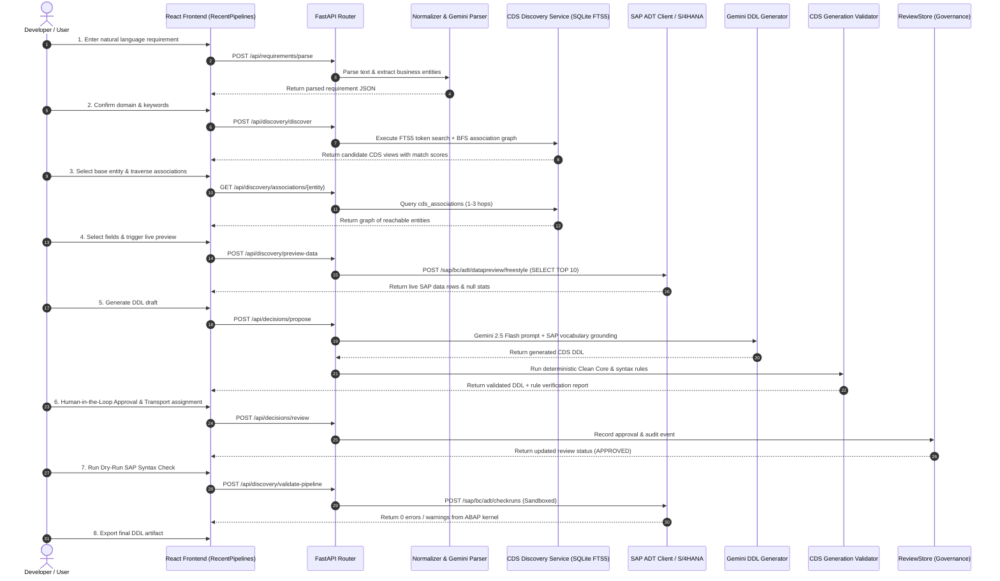

# 03 - End-to-End Data Flow

## 1. High-Level Pipeline Sequence Diagram



---

## 2. Exhaustive Step-by-Step Data Flow (13 Stages)

### Stage 1: Natural Language Requirement Prompt
* **User Action**: The user enters an operational requirement in `RecentPipelines.tsx`:
  > *"Create a CDS view for open sales orders with customer credit limit and delivery status from Germany"*
* **Trigger**: Clicking **"Analyze Requirement"**.
* **Payload**: `{"raw_text": "Create a CDS view for open sales orders..."}` sent via `POST /api/requirements/parse`.

### Stage 2: Structured Requirement Parsing
* **Execution**: `backend/src/api/routes/requirements.py` invokes `GeminiService.parse_requirement()` with fallback to regex extraction in `Normalizer`.
* **Output Payload**:
  ```json
  {
    "business_goal": "Report open sales orders with credit limit and delivery status",
    "entities": ["SalesOrder", "Customer", "Delivery"],
    "filters": [{"field": "Country", "operator": "=", "value": "DE"}],
    "granularity": "SalesOrderItem",
    "required_metrics": ["GrossAmount", "CreditLimit"]
  }
  ```

### Stage 3: Domain Classification & Canonical Keyword Tagging
* **Execution**: `backend/src/services/normalizer.py` executes `resolve_domain_from_sap_metadata()` and synonym clustering.
* **Logic**: "Sales Order" maps to `SD` (Sales and Distribution), "Customer" maps to `SD`/`FI`, "Delivery" maps to `LE`/`SD`.
* **Canonical Keywords**: `["SALES_ORDER", "CUSTOMER", "DELIVERY", "CREDIT"]`.

### Stage 4: CDS Discovery & Semantic Match Scoring
* **Execution**: `backend/src/services/discovery_service.py` -> `CDSDiscoveryService.discover_views()`.
* **Algorithm**:
  1. Executes SQLite FTS5 query on `cds_views_fts`:
     ```sql
     SELECT cds_name, label, domain, package, rank 
     FROM cds_views_fts 
     WHERE cds_views_fts MATCH 'Sales Order' 
     ORDER BY rank LIMIT 50;
     ```
  2. Applies 6-level composite scoring formula:
     $$\text{Score} = w_1 S_{\text{exact}} + w_2 S_{\text{prefix}} + w_3 S_{\text{fts}} + w_4 S_{\text{domain}} + w_5 S_{\text{grain}} + w_6 S_{\text{package}}$$
  3. Returns top candidate views (e.g., `I_SalesOrder`, `I_SalesOrderItem`, `I_Customer`).

### Stage 5: Multi-Hop Association Graph Navigation
* **Execution**: `CDSDiscoveryService.find_association_paths()`.
* **Algorithm**:
  * Runs Breadth-First Search (BFS) starting at root node `I_SalesOrderItem`.
  * Inspects `cds_associations` table for targets up to 3 hops away.
  * Identifies paths:
    * Hop 1: `I_SalesOrderItem` $\rightarrow$ `_SalesOrder` (`I_SalesOrder`)
    * Hop 2: `I_SalesOrder` $\rightarrow$ `_SoldToParty` (`I_Customer`)
    * Hop 3: `I_Customer` $\rightarrow$ `_CreditAccount` (`I_CustomerCreditProfile`)
* **Output**: Graph model rendered as an interactive node-edge map in the UI.

### Stage 6: Field Selection & Grain Alignment
* **Execution**: `GET /api/discovery/views/{cds_name}/fields`.
* **Logic**:
  * Loads field definitions from `cds_fields`.
  * If fields are not present in local SQLite, dynamically calls `SAPADTClient.fetch_ddl()` to parse fields on the fly.
  * Evaluates grain conflicts: flags when joining a header entity (`1:1`) to item entities (`1:N`) to prevent fan-out row explosion.

### Stage 7: Live Data Preview & Null Sampling
* **Execution**: `POST /api/discovery/preview-data`.
* **Safety Guard**: `SAPADTClient._assert_zero_write_policy` confirms the request is a read-only query.
* **SAP Interaction**:
  * Issues `POST /sap/bc/adt/datapreview/freestyle` to SAP S/4HANA:
    ```sql
    SELECT TOP 10 SalesOrder, SalesOrderItem, NetAmount, TransactionCurrency 
    FROM I_SalesOrderItem
    ```
* **Analysis**: Backend computes null percentage per field, distinct value counts, and min/max values to warn users if proposed fields are empty.

### Stage 8: DDL Draft Generation (Deterministic vs Gemini LLM)
* **Execution**: `GeminiService.generate_cds_ddl()` or deterministic template fallback.
* **Prompt Grounding**:
  * System prompt instructs Gemini 2.5 Flash to generate valid ABAP Core Data Services DDL.
  * Injects exact entity schemas, selected fields, association names, and SAP annotations:
    ```abap
    @AccessControl.authorizationCheck: #CHECK
    @EndUserText.label: 'Custom Open Sales Order Analysis'
    @VDM.viewType: #COMPOSITE
    define view entity ZI_OpenSalesOrderAnalysis
      as select from I_SalesOrderItem as Item
      association [1..1] to I_Customer as _Customer 
        on $projection.SoldToParty = _Customer.Customer
    {
      key Item.SalesOrder,
      key Item.SalesOrderItem,
      Item.SoldToParty,
      _Customer.CustomerName,
      @Semantics.amount.currencyCode: 'TransactionCurrency'
      Item.NetAmount,
      Item.TransactionCurrency
    }
    ```

### Stage 9: Multi-Layer Rule Validation & Clean Core Verification
* **Execution**: `CDSGenerationValidator.validate_ddl(ddl)`.
* **Deterministic Rules Enforced**:
  1. **Namespace Check**: Entity name MUST begin with `Z` or `Y`.
  2. **SQL View Name**: If `@AbapCatalog.sqlViewName` is provided, length must be $\le 16$ characters.
  3. **Clean Core Verification**: Base entities must be released `I_*` or custom `Z*`/`Y*` views. Direct queries on `VBAK`, `VBAP`, etc., fail immediately.
  4. **Key Integrity**: View entity must declare at least one `key` element.
  5. **Currency / Unit Pairing**: Any field annotated with `@Semantics.amount` must reference a valid currency code field in the projection.

### Stage 10: Human-in-the-Loop Governance & Role Approval Gates
* **Execution**: `ReviewStore` in `backend/src/services/review_service.py`.
* **Gate States**:
  * `DRAFT` $\rightarrow$ Developer creates and tests DDL.
  * `PENDING_REVIEW` $\rightarrow$ Submitted for architectural evaluation.
  * `APPROVED` $\rightarrow$ Signed off by authorized role.
  * `REJECTED` $\rightarrow$ Returned with remediation feedback.
* **Audit Trail**: Every action logs timestamp, reviewer ID, diff, and status.

### Stage 11: Active CTS Transport Selection & Package Assignment
* **Execution**: `GET /api/discovery/transports` and `GET /api/discovery/packages`.
* **Logic**:
  * Queries SAP CTS (Change and Transport System) via ADT for open workbench requests assigned to the current developer.
  * Validates development package (e.g., `Z_SALES_EXT` or `$TMP` for local testing).

### Stage 12: Dry-Run Checkrun & ABAP Syntax Verification
* **Execution**: `POST /api/discovery/validate-pipeline`.
* **SAP Interaction**:
  * Calls `SAPADTClient.run_syntax_check(ddl_source, object_name)`.
  * Sends payload to `POST /sap/bc/adt/checkruns`.
  * The ABAP Kernel parses the DDL in memory and returns syntax errors, warnings, or confirmation of zero issues without persisting the object.

### Stage 13: Final DDL Export & Execution Log Audit
* **Execution**: Developer clicks **"Export DDL"** or **"Copy to Clipboard"**.
* **Audit Record**: The finalized DDL, along with its validation certificate, checkrun results, and user approvals, is archived in the governance audit store for compliance tracking.
