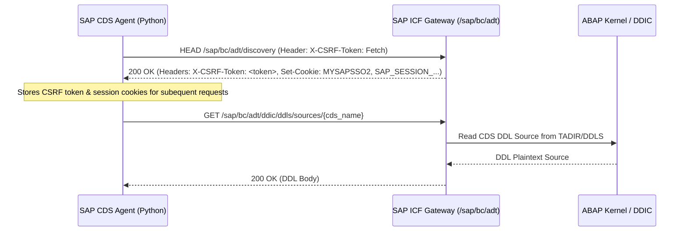

# 07 - SAP ADT & CDS Discovery Engine

## 1. SAP ADT REST Protocol Architecture

### What is SAP ADT?
**ABAP Development Tools (ADT)** is SAP's modern, HTTP/REST-based development interface running on the ABAP Internet Communication Framework (ICF). While Eclipse IDE uses ADT to provide developer tooling, the SAP CDS Agent communicates with the same ADT REST endpoints directly via Python `httpx`/`requests`.

* **Base ICF Root**: `/sap/bc/adt`
* **Transport Protocol**: HTTPS on port `44301`
* **Authentication**: HTTP Basic Auth with session cookie persistence.



---

## 2. Stateful CSRF Token & Session Lifecycle

SAP ADT enforces stateful Cross-Site Request Forgery (CSRF) protection for all mutating or execution endpoints (`POST`, `PUT`, `DELETE`). The `SAPADTClient` (`backend/src/sap/adt_client.py`) manages this lifecycle transparently:

1. **Token Fetching**:
   * Prior to executing any checkrun or data preview, `SAPADTClient.fetch_csrf_token()` sends an initial `HEAD` or `GET` request to `/sap/bc/adt/discovery` with `X-CSRF-Token: Fetch`.
   * The response header `x-csrf-token` is cached in memory along with all session cookies (`SAP_SESSION_*`).
2. **Token Renewal on Expiry**:
   * If SAP terminates the session or responds with `403 Forbidden` (`CSRF token validation failed`), the client automatically invalidates the cached token, re-executes the handshake, and replays the original request.

---

## 3. The Zero-Write Security Guard (`_assert_zero_write_policy`)

To prevent accidental modification, creation, or corruption of objects in the SAP S/4HANA system, `SAPADTClient` implements a strict **pre-socket interception hook**:

```python
def _assert_zero_write_policy(self, method: str, url: str) -> None:
    """
    Guarantees that the SAP CDS Agent NEVER writes, creates, alters,
    or deletes any object in the connected SAP system.
    """
    method_upper = method.upper()
    
    # 1. Block all destructive HTTP verbs outright
    if method_upper in ("PUT", "DELETE", "PATCH"):
        raise SecurityException(
            f"Zero-Write Policy Violation: HTTP method '{method_upper}' is strictly prohibited."
        )

    # 2. POST is permitted ONLY for sandboxed, read-only functional endpoints
    if method_upper == "POST":
        allowed_post_paths = [
            "/sap/bc/adt/datapreview/freestyle",  # Read-only SQL query preview
            "/sap/bc/adt/checkruns",              # In-memory syntax verification checkrun
            "/sap/bc/adt/discovery",              # CSRF handshake discovery
        ]
        if not any(path in url for path in allowed_post_paths):
            raise SecurityException(
                f"Zero-Write Policy Violation: POST to '{url}' is unauthorized."
            )
```
* **Guarantee**: Even if a buggy prompt or malicious user attempts to generate code that instructs an object save, the HTTP request is aborted before reaching the network socket.

---

## 4. In-Memory ABAP Checkruns (`POST /sap/bc/adt/checkruns`)

The platform tests generated DDL code directly against the real SAP ABAP compiler without persisting objects:
* **Endpoint**: `/sap/bc/adt/checkruns`
* **Payload**: XML containing the proposed DDL source code and virtual target object name.
* **Mechanism**: The ABAP kernel parses and type-checks the DDL against the active SAP DDIC dictionary in memory.
* **Return**: XML document listing all compiler errors, warnings, syntax mismatches, or an empty `<checkrunMessages>` tag indicating **100% valid syntax**.

---

## 5. Live Data Preview (`POST /sap/bc/adt/datapreview/freestyle`)

To allow developers to verify the contents of standard CDS views prior to code generation:
* **Endpoint**: `/sap/bc/adt/datapreview/freestyle`
* **Query Format**: `SELECT TOP 10 * FROM <CDS_NAME>`
* **Safety Rules**:
  * Mandatory row limiting (`TOP 10` or `UP TO 10 ROWS`).
  * Only `SELECT` statements are permitted.
* **Null & Cardinality Profiling**: The backend computes column statistics (null percentages, distinct counts) to help developers detect unpopulated fields before authoring DDL.

---

## 6. CDS Discovery & Association Graph Traversal

### 6.1 The 6-Level Composite Evidence Scoring Formula
When a developer enters a search query, `CDSDiscoveryService` scores matching views using a weighted composite formula:

$$\text{FinalScore} = (w_1 \cdot S_{\text{exact}}) + (w_2 \cdot S_{\text{prefix}}) + (w_3 \cdot S_{\text{fts}}) + (w_4 \cdot S_{\text{domain}}) + (w_5 \cdot S_{\text{grain}}) + (w_6 \cdot S_{\text{package}})$$

| Component | Weight | Criteria |
|---|---|---|
| **$S_{\text{exact}}$** | 0.30 | Exact match with technical CDS name or label |
| **$S_{\text{prefix}}$** | 0.20 | Prefix match (e.g. `I_Sales*`) |
| **$S_{\text{fts}}$** | 0.20 | SQLite FTS5 BM25 normalized relevance rank |
| **$S_{\text{domain}}$** | 0.15 | Domain matches classified intent (`SD`, `FI`, etc.) |
| **$S_{\text{grain}}$** | 0.10 | Grain matches requested level (Header vs. Item) |
| **$S_{\text{package}}$** | 0.05 | Package belongs to active core application component |

### 6.2 Multi-Hop Association Graph Traversal (BFS)
Rather than requiring developers to manually explore SAP documentation, `CDSDiscoveryService.find_association_paths()` executes Breadth-First Search (BFS) over the `cds_associations` table:

```
[ Root: I_SalesOrderItem ]
      |
      +--- Hop 1: _SalesOrder ----> [ I_SalesOrder ]
      |                                  |
      |                                  +--- Hop 2: _SoldToParty ----> [ I_Customer ]
      |                                                                      |
      |                                                                      +--- Hop 3: _CreditProfile ----> [ I_CustomerCreditProfile ]
      +--- Hop 1: _Material   ----> [ I_Product ]
```

* **Max Depth**: Traversal is capped at 3 hops to prevent cycle explosion and ensure sub-second response times.
* **Result**: Renders an interactive, clickable relationship map in the UI.

### 6.3 On-Demand Field Ingestion with Live Fallback
If a user selects an entity whose fields are not pre-indexed in `cds_fields`:
1. `CDSDiscoveryService` calls `SAPADTClient.fetch_ddl(cds_name)`.
2. Passes raw DDL to `CDSDDLParser`.
3. Extracts technical fields, data types, and key flags.
4. Persists the parsed fields into `cds_fields` in `sap_cds.db` so future queries execute instantly from local storage.
