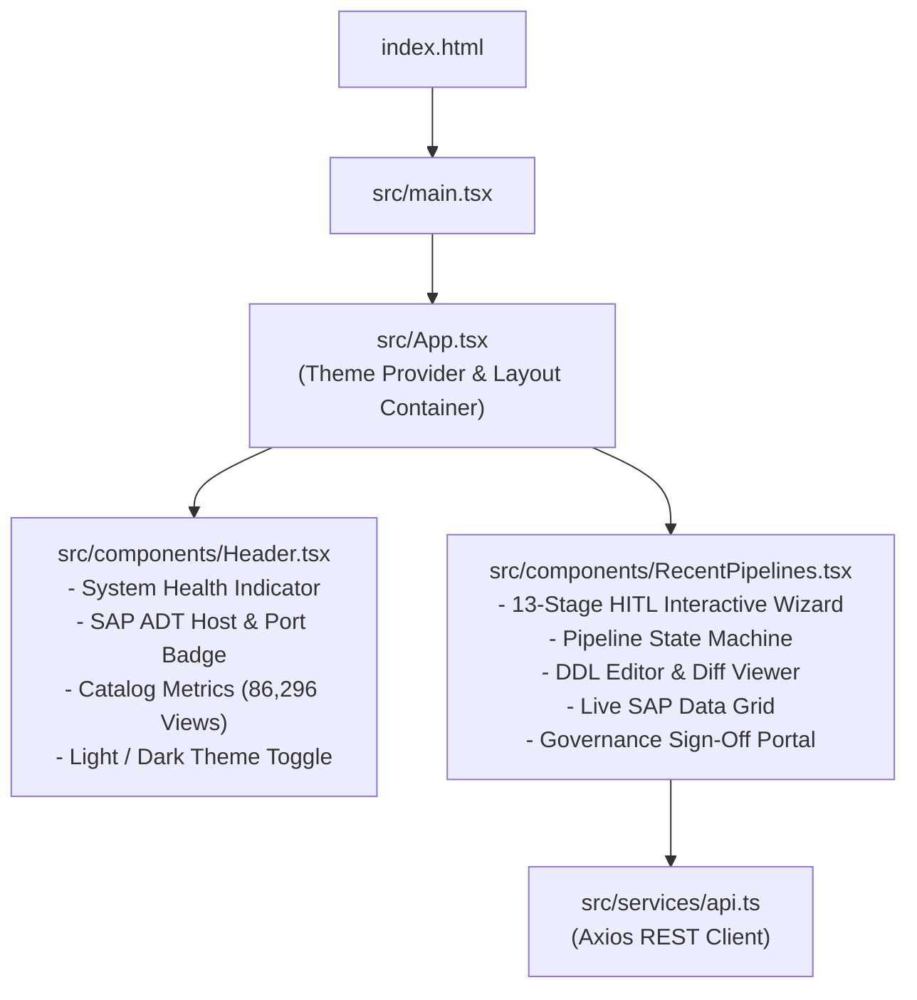

# 09 - Frontend Walkthrough & UI Architecture

## 1. Frontend Technology Stack & Design System

The SAP CDS Agent user interface is engineered as a modern, high-performance Single Page Application (SPA):
* **Core Framework**: React 18.2 with TypeScript for complete type safety across all API payloads.
* **Build System**: Vite 5 for instant Hot Module Replacement (HMR) and optimized production bundles.
* **Styling**: Tailwind CSS with enterprise color palettes:
  * Dark Slate / Charcoal backgrounds for technical focus.
  * Emerald accents for Clean Core compliance and successful checks.
  * Amber badges for warnings (grain mismatches, high null percentages).
  * Rose badges for syntax errors and Clean Core violations.
* **Icons**: `lucide-react` for crisp vector iconography.
* **HTTP Client**: Axios with configured base URLs, request/response interceptors, and error handling.

---

## 2. Component Hierarchy & Layout



---

## 3. Deep Dive: `RecentPipelines.tsx` State Machine (~3,500 Lines)

`RecentPipelines.tsx` is the primary orchestrator of the entire developer workflow. It implements a deterministic 13-stage state machine that guides users from unstructured business requirements to SAP-verified, production-ready DDL code.

### Pipeline State Structure
```typescript
interface PipelineState {
  currentStep: number;             // 1 to 13
  requirementText: string;         // User natural language prompt
  parsedRequirement: ParsedReq;    // Structured entities, metrics, filters
  selectedDomain: string;          // Business domain (SD, MM, FI, etc.)
  discoveredViews: CDSView[];      // Candidate views from FTS5 catalog
  selectedBaseView: string;        // Chosen root CDS entity (e.g. I_SalesOrderItem)
  associationGraph: GraphNode[];   // Traversed association paths (1-3 hops)
  selectedAssociations: string[];  // Checked associations to include
  selectedFields: FieldSelection[];// Chosen fields with aliases and grain flags
  livePreviewData: PreviewResult;  // Live data rows & null profiles from SAP ADT
  generatedDDL: string;            // Synthesized DDL code draft
  validationResults: ValidationReport; // Clean Core & deterministic lint report
  reviewStatus: 'DRAFT' | 'PENDING' | 'APPROVED' | 'REJECTED';
  selectedTransport: string;       // SAP CTS workbench request (e.g. DEVK901234)
  targetPackage: string;           // Target ABAP package (e.g. Z_SALES)
  checkrunResult: CheckrunReport;  // Live ABAP compiler syntax check response
}
```

---

## 4. The 13 Interactive Pipeline Stages in the UI

### Stage 1 & 2: Natural Language Requirement & Parsing
* **UI Controls**: Multi-line auto-expanding textarea, sample prompts dropdown (e.g., *"Sales Order Billing Analysis"*, *"Material Stock Aging"*), and **"Analyze Requirement"** action button.
* **Visual Feedback**: Real-time parsing spinner followed by structured badge displays showing detected Business Goals, Entities, Metrics, and Filters.

### Stage 3: Domain & Canonical Keyword Review
* **UI Controls**: Domain selector pills (`SD`, `MM`, `FI`, `CO`, `PP`, etc.) pre-highlighted based on `Normalizer` detection.
* **Interactive Elements**: Editable canonical tags allowing developers to add or prune keyword tokens prior to catalog discovery.

### Stage 4: CDS View Discovery & Scoring Grid
* **UI Controls**: Tabular list of discovered CDS views with real-time search filtering.
* **Visual Indicators**:
  * Match Score Progress Bar ($0\%$ to $100\%$).
  * Score Breakdown tooltip showing exact, prefix, FTS, domain, and grain weights.
  * Virtual Data Model tag: `[Basic / Interface]`, `[Composite]`, `[Consumption]`.

### Stage 5: Multi-Hop Association Graph Explorer
* **UI Controls**: Interactive node-link graph visualization.
* **User Action**: Clicking root entity reveals expandable tree nodes for 1st-hop, 2nd-hop, and 3rd-hop associations (e.g., `_SalesOrder` $\rightarrow$ `_SoldToParty` $\rightarrow$ `_CreditAccount`).
* **Checkboxes**: Developers select which associations to project or expose.

### Stage 6: Field Selection & Grain Alignment Matrix
* **UI Controls**: Dual-pane field picker categorized by source entity.
* **Safety Badges**:
  * **Grain Conflict Alert**: Triggers a warning if user combines 1:1 header fields with 1:N item fields without explicit aggregation.
  * **Key Indicator**: Primary key fields locked with key icons to prevent invalid DDL projections.

### Stage 7: Live SAP Data Preview & Null Profiler
* **UI Controls**: Embedded responsive data grid showing top 10 rows fetched directly from SAP S/4HANA.
* **Null Percentage Bar**: Displays percentage of `NULL` / blank values per column in red/green to alert developers against building logic on unpopulated SAP standard fields.

### Stage 8: DDL Code Generator & Interactive Editor
* **UI Controls**: Code editor with syntax highlighting, line numbering, and copy-to-clipboard functionality.
* **Toggle**: Switch between Gemini 2.5 Flash AI-synthesized DDL and deterministic template baseline.

### Stage 9: Clean Core Verification Dashboard
* **UI Controls**: Checklist of deterministic Clean Core compliance rules:
  * `[PASS]` Customer namespace enforced (`Z*`/`Y*`)
  * `[PASS]` SQL view name $\le 16$ characters
  * `[PASS]` Zero direct table queries (no `VBAK`, `VBAP`)
  * `[PASS]` Currency and quantity semantics paired
  * `[PASS]` `@AccessControl.authorizationCheck` defined

### Stage 10: Human-in-the-Loop Governance Portal
* **UI Controls**: Role approval cards (Developer, Lead Architect, Security Officer).
* **Action Buttons**: **"Approve & Sign-Off"**, **"Request Changes"**, **"Reject"**.
* **Audit Trail**: Real-time log showing reviewer comments, timestamps, and signature hashes.

### Stage 11: SAP CTS Transport & Package Picker
* **UI Controls**: Dropdown fetching active open workbench requests (`DEVK*`) from the connected SAP system and package input field (`Z*` or `$TMP`).

### Stage 12: Dry-Run SAP Syntax Checkrun Terminal
* **UI Controls**: Console-style terminal executing live checkrun against the ABAP kernel.
* **Visual State**:
  * Green Banner: `0 Errors, 0 Warnings - ABAP Kernel Validated`.
  * Red Alert Box: Displays exact line numbers and compiler error text if syntax is rejected.

### Stage 13: Final DDL Export & Execution Summary
* **UI Controls**: One-click download button for `.ddls` file, direct clipboard copy, and comprehensive summary receipt of the entire 13-stage execution pipeline.
